# MFT-to-MFT Integration Layer — Architecture & Conceptual Guide

> **Purpose:** This README explains the proposed integration layer that coordinates file movement and processing between source and destination managed-file-transfer endpoints, using the example interface/configuration discussed here.
>
> **Important accuracy note:** The supplied configuration uses `MFT_SFTP` endpoints (host, port 22, directory, SSH-key auth profile). That alone does **not** prove that the endpoints are IBM MQ Managed File Transfer (IBM MQ MFT) agents. IBM MQ MFT uses its own agent/queue-manager topology and transfer-submission/status mechanisms. The integration must be aligned with the actual enterprise IBM MQ MFT deployment before implementation.

---

## Table of Contents

1. [Problem and goal](#1-problem-and-goal)
2. [What IBM MQ MFT is](#2-what-ibm-mq-mft-is)
3. [What our integration layer is—and is not](#3-what-our-integration-layer-isand-is-not)
4. [High-level architecture](#4-high-level-architecture)
5. [Architecture layers and responsibilities](#5-architecture-layers-and-responsibilities)
6. [IBM MQ MFT fundamentals](#6-ibm-mq-mft-fundamentals)
7. [Managed transfer concept and flow](#7-managed-transfer-concept-and-flow)
8. [Adapter design: Read and Write](#8-adapter-design-read-and-write)
9. [Configuration-driven design](#9-configuration-driven-design)
10. [Example interface configuration](#10-example-interface-configuration)
11. [Source S4: input-file source](#11-source-s4-input-file-source)
12. [Target T2: output-file destination](#12-target-t2-output-file-destination)
13. [Payload layouts](#13-payload-layouts)
14. [Routes and workflows](#14-routes-and-workflows)
15. [Workflow A: raw-copy route](#15-workflow-a-raw-copy-route)
16. [Workflow B: reconciliation transformation route](#16-workflow-b-reconciliation-transformation-route)
17. [End-to-end sequence](#17-end-to-end-sequence)
18. [Checksums and file integrity](#18-checksums-and-file-integrity)
19. [Temporary files and atomic publication](#19-temporary-files-and-atomic-publication)
20. [Manifest and audit lineage](#20-manifest-and-audit-lineage)
21. [Security and credentials](#21-security-and-credentials)
22. [Retries, idempotency, recovery and error handling](#22-retries-idempotency-recovery-and-error-handling)
23. [Status tracking and observability](#23-status-tracking-and-observability)
24. [What the Java/Spring Boot application communicates with](#24-what-the-javaspring-boot-application-communicates-with)
25. [Proposed Spring Boot components](#25-proposed-spring-boot-components)
26. [What needs to be provided to IBM MFT / platform team](#26-what-needs-to-be-provided-to-ibm-mft--platform-team)
27. [What must be clarified before implementation](#27-what-must-be-clarified-before-implementation)
28. [Glossary](#28-glossary)
29. [References and validation](#29-references-and-validation)

---

## 1. Problem and goal

The goal is to create a **configuration-driven integration layer** that can manage file-transfer workflows across source and destination systems without hardcoding the file locations, file patterns, layout, transformation, authentication references, retry policy, or delivery rules in application code.

The integration layer is intended to:

- Discover files at configured source locations.
- Verify file integrity where configured.
- Parse files when a route requires parsing.
- Transform and validate records where required.
- Deliver output to configured destinations.
- Track each run and transfer.
- Support retry, recovery, audit, and controlled re-execution.
- Support different interfaces and routes through configuration.

### Concept

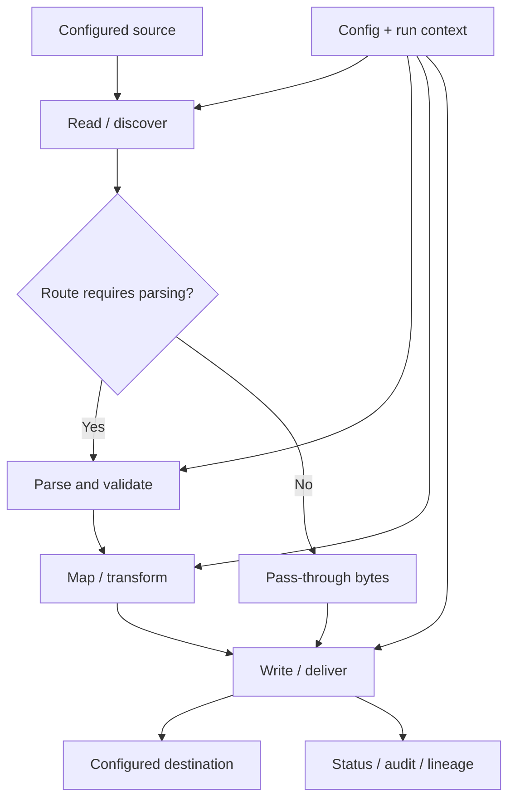

The application should be driven by the interface configuration and route definition. It should not require a separate hardcoded application flow for each interface.

---

## 2. What IBM MQ MFT is

**IBM MQ Managed File Transfer (IBM MQ MFT)** is a managed file-transfer capability within the IBM MQ ecosystem. It is designed to move files between managed endpoints, with transfer control, status and operational management provided by its MFT infrastructure.

It is not simply a Java library that copies a file. In an IBM MQ MFT deployment, transfer management involves MFT agents and IBM MQ infrastructure, with roles such as coordination and agent queue managers depending on the topology and deployment.

### What IBM MQ MFT can provide (deployment-dependent)

- Managed transfer execution between configured endpoints.
- Transfer coordination and operational status.
- Agent-based transfer endpoints.
- Transfer control and management facilities.
- Operational visibility and recovery capabilities, subject to the deployment and configuration.
- Support for file-transfer patterns and integrations supported by the installed IBM MQ MFT version.

**Do not assume every feature, interface, command, REST API or topology is available in the target environment.** The installed IBM MQ MFT version, topology, permissions, and platform standards must be checked.

---

## 3. What our integration layer is—and is not

### Our integration layer

Our application is the **configuration-driven workflow/control layer**. It determines:

- Which interface is running.
- Which product/business route applies.
- Which source and destination are configured.
- Which files qualify.
- Which layout is used.
- Whether the route parses/transforms or copies bytes.
- Which transfer operation is requested.
- Which integrity, delivery and audit policies apply.
- How the application records run-level status and errors.

### It is not intended to replace IBM MQ MFT

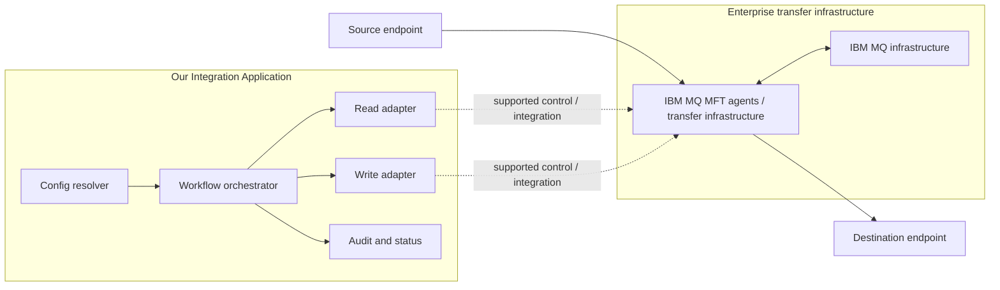

The integration application coordinates and records work. IBM MQ MFT—if the environment actually uses IBM MQ MFT agents for the transfer—performs the managed-transfer operation according to its supported mechanisms.

### A critical distinction: SFTP versus IBM MQ MFT

The configuration example defines `MFT_SFTP` connections with:

- Hostname
- Port 22
- Directory
- SSH-key authentication profile

Those values describe an SFTP endpoint connection configuration. **They do not, by themselves, establish an IBM MQ MFT agent-to-agent transfer.**

If the intended platform is IBM MQ MFT agent-to-agent, configuration may also need deployment-specific information such as agent names, queue-manager relationships, transfer submission/control mechanism, and operational/status integration. These must be confirmed with the IBM MQ MFT platform team. The design must not pretend that ordinary SFTP connection properties are sufficient for every IBM MQ MFT transfer.

---

## 4. High-level architecture

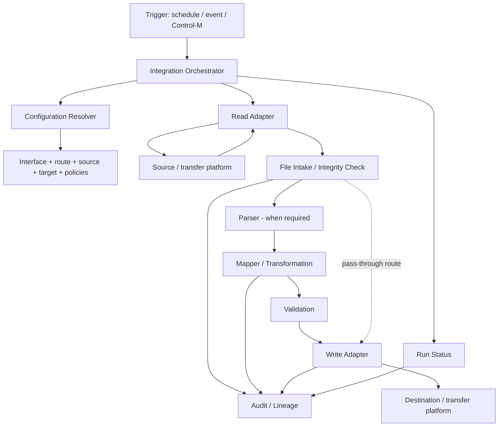

### Architectural flow

1. A scheduler, Control-M, event, or approved trigger starts a route.
2. The orchestrator receives a route, interface, product, and run context.
3. The configuration resolver loads the published configuration snapshot.
4. The Read Adapter obtains or arranges source-file discovery/transfer, according to the chosen platform integration.
5. Intake checks identify eligible files and apply configured integrity checks.
6. The file-processing stage parses, maps, and validates if the route requires it.
7. The Write Adapter requests/executes destination delivery according to the supported transfer model.
8. The application tracks transfer and workflow states and writes audit/lineage data.

---

## 5. Architecture layers and responsibilities

| Layer | Responsibility |
|---|---|
| Trigger / scheduler | Starts the route on schedule, event or approved trigger |
| Orchestrator | Coordinates stages and decisions; does not embed endpoint details |
| Configuration resolver | Resolves interface/version/product/route/source/target and policy configuration |
| Read adapter | Abstracts source-side discovery/read or managed-transfer initiation, depending on platform design |
| Intake / integrity | File eligibility, checksum verification, file metadata and intake decisions |
| Parser | Converts file bytes into records using the configured layout; only used when required |
| Mapper / transformation | Applies business mapping or transformation |
| Validation | Checks structural and business constraints; records rejection reasons |
| Write adapter | Abstracts destination write/delivery or managed-transfer initiation |
| Transfer/status manager | Tracks application workflow and transfer statuses |
| Retry/recovery manager | Applies configured retry and recovery behavior |
| Audit/lineage | Records run, file, transfer, outcome, checksum and lineage details |
| Security/configuration | Secure configuration and secrets resolution, access control and protection of sensitive information |

---

## 6. IBM MQ MFT fundamentals

Terminology varies slightly with version and deployment. Confirm the target platform's actual topology.

### MFT agent

An MFT agent is a managed endpoint component that participates in file-transfer operations. It is associated with the file-system access and transfer execution responsibilities configured for that agent.

### Agent queue manager

An agent queue manager is part of the IBM MQ infrastructure used by an MFT agent in the configured topology. The precise configuration and relationships are platform-specific.

### Coordination queue manager

The coordination queue manager is an MFT infrastructure role used for coordination/management information in applicable topologies. It should not be confused with the physical source or destination file directory.

### Transfer request

A transfer request describes the transfer to be carried out—for example, source agent, source file(s), destination agent, destination directory/file, and relevant transfer options. The exact mechanism for submitting requests must be confirmed for the deployed IBM MQ MFT environment.

### Transfer status

The MFT infrastructure may expose transfer status and related operational information through supported tools and mechanisms. The application should correlate that status to its own workflow/run identifiers rather than assume that MFT status alone represents the full business workflow.

### Conceptual roles

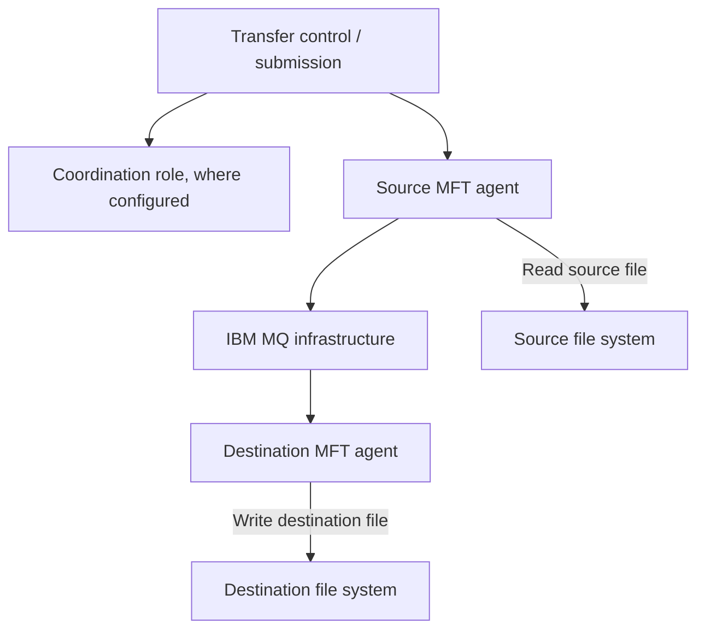

This is a **conceptual diagram**, not a deployment topology. It intentionally does not prescribe the actual queue-manager network, channels, agent configuration, or control interfaces.

---

## 7. Managed transfer concept and flow

At a conceptual level, a managed transfer moves a file from a source managed endpoint to a destination managed endpoint under transfer control.

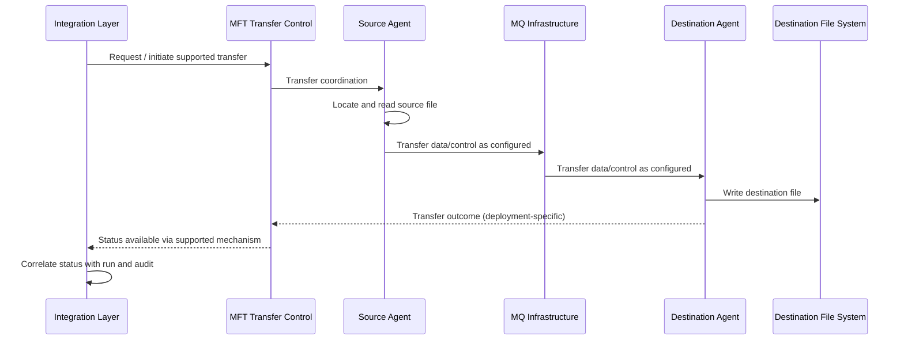

**This diagram is illustrative.** Actual MFT transfer paths, communication patterns, submission interfaces, status collection and data movement details vary by deployment. Validate with IBM MQ MFT documentation and the enterprise MFT team.

### Why managed-transfer infrastructure may be preferable

For large file transfers, an agent-managed transfer can avoid making the integration application the data-carrying intermediary—**if** the deployed IBM MQ MFT setup supports the required source/destination topology and operation. This can reduce application memory/storage pressure and keep transfer execution within the managed platform.

It is not a universal requirement. If the actual endpoints are plain SFTP endpoints and the chosen design uses application-mediated SFTP, then the application may have to read/write the bytes itself. That is a different implementation model and must be designed and secured accordingly.

---

## 8. Adapter design: Read and Write

Adapters should expose a stable application-level contract while hiding endpoint/platform details. Their exact implementation depends on whether the enterprise uses IBM MQ MFT agents, application-mediated SFTP, or another supported transfer mechanism.

### Read Adapter

Logical responsibilities:

- Resolve the source reference from configuration.
- Apply the configured source file pattern.
- Discover eligible file(s), or submit/coordinate a supported transfer operation.
- Retrieve or expose file metadata: filename, size, timestamps and identifiers where available.
- Coordinate source integrity checks when configured.
- Return a controlled result to the orchestrator.
- Report errors in a consistent application format.

### Write Adapter

Logical responsibilities:

- Resolve the target reference from configuration.
- Generate or resolve destination file names.
- Apply target delivery options.
- Request or execute delivery via the selected transfer mechanism.
- Support temporary-file/commit behavior where the endpoint and transfer mechanism support it.
- Coordinate checksum companion and manifest delivery.
- Report status/errors consistently.

### Adapter boundary

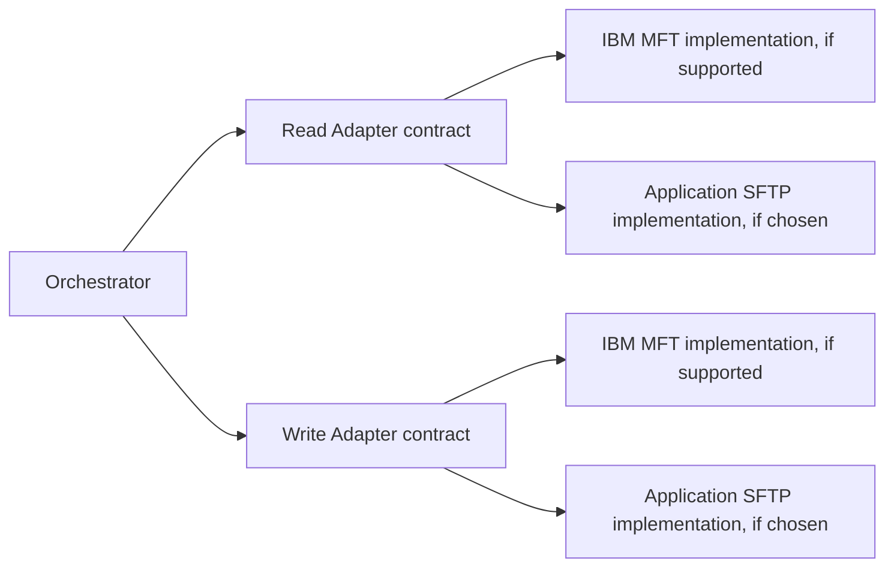

The adapter contract should avoid leaking IBM MQ MFT command details into business-route logic. Platform-specific operations belong behind the adapter boundary.

---

## 9. Configuration-driven design

The route should be driven by configuration rather than hardcoded business flows.

### Configuration should identify

- Interface identity and version.
- Interface publication status.
- Applicable product/business context.
- Source connection and source definition.
- Destination connection and destination definition.
- Layout(s).
- Mapping definition.
- Route/stage sequence.
- Trigger details.
- Authentication references—not secrets.
- Integrity and checksum policy.
- Delivery and file-publication policy.
- Retry and error-handling policy.
- Re-execution/idempotency policy.
- Audit and lineage policy.

### Conceptual configuration resolution

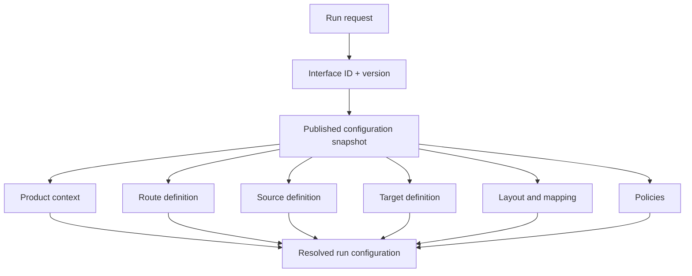

### Why a published snapshot matters

A run should resolve to a specific configuration version/snapshot. This makes the workflow reproducible and allows audit to record which configuration was used. The supplied example describes a published interface configuration with versioning and snapshot immutability; preserve that principle in the implementation.

---

## 10. Example interface configuration

The configuration context discussed in this design contains:

| Property | Value |
|---|---|
| Interface ID | `INT_CM_001` |
| Interface name | `ANVIL_TRADE_AND_RECON_DISTRIBUTION` |
| Domain | `CAPITAL_MARKETS` |
| Version | `2.1.0` |
| Status | `PUBLISHED` |
| Effective from | `2026-11-18` |
| Product associations | `REPO`, `SEC_LENDING` |

The example has a registry snapshot of connections and authentication profiles, file layouts, source/target definitions, routes, mapping rules, and execution policy.

### Connection registry (relevant entries)

| Connection | Type / method | Configuration described |
|---|---|---|
| `C_ANVIL` | `ION_ANVIL_SDK` | Adapter/SDK-based connection |
| `C_REFERENCE_API` | `REST_API` | Reference API |
| `C_SETTLEMENT_MQ` | `IBM_MQ` | IBM MQ connection |
| `C_FILE_IN` | `MFT_SFTP` | `mft-in.example.internal`, port 22, `/incoming/positions`, `AUTH_MFT_IN` |
| `C_RISK_KAFKA` | `Kafka` | Kafka connection |
| `C_FILE_OUT` | `MFT_SFTP` | `mft-out.example.internal`, port 22, `/outgoing/recon`, `AUTH_MFT_OUT` |
| `C_CONTROL_M_INVOKE` | Inbound HTTPS | Control-M invocation route |

The two file connections are labelled `MFT_SFTP` in this configuration. This should not be mistaken for a confirmed IBM MQ MFT agent topology.

### Authentication profiles

| Profile | Method | Secret reference |
|---|---|---|
| `AUTH_MFT_IN` | SSH key | `vault://cm/mft/input-key` |
| `AUTH_MFT_OUT` | SSH key | `vault://cm/mft/output-key` |

Secrets are referenced, not embedded in the interface configuration.

---

## 11. Source S4: input-file source

### Configuration described

| Property | Value |
|---|---|
| Source ID | `S4` |
| Name | `POSITION_FILE_PLATFORM` |
| Method | `MFT_SFTP` |
| Connection ref | `C_FILE_IN` |
| Role | `BATCH_FILE` |
| Layout | `L_POSITIONS_FIXED` |
| Applies to | `SEC_LENDING` |
| File pattern | `SL_POSITIONS_*.dat` |
| Checksum companion | `${source.fileName}.sha256` |
| Integrity algorithm | SHA-256 |
| Checksum failure | `TECH-FILE-001` |

### Source flow

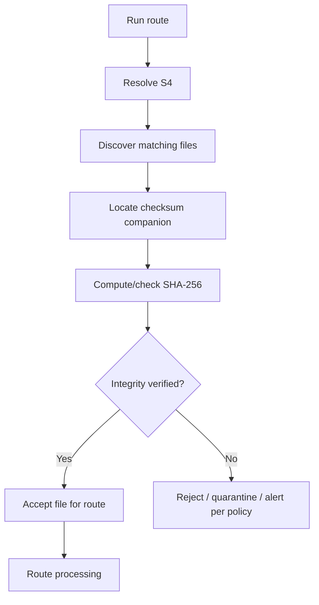

### What this means

1. The route resolves `S4`.
2. The source pattern identifies candidate position files.
3. The checksum companion is required according to the configuration.
4. The configured checksum is checked against the file.
5. A mismatch is associated with `TECH-FILE-001` and handled according to the configured policy.
6. An accepted file is handed to the next stage.

The exact discovery, download/read, checksum retrieval and source disposition operations depend on the selected transfer platform.

---

## 12. Target T2: output-file destination

### Configuration described

| Property | Value |
|---|---|
| Target ID | `T2` |
| Name | `RECON_PLATFORM` |
| Method | `MFT_SFTP` |
| Connection ref | `C_FILE_OUT` |
| Layout | `L_RECON_DELIMITED` |
| Applies to | `SEC_LENDING` |
| File name pattern | `SL_RECON_${context.businessDate}_${context.runId}.txt` |
| Temporary suffix | `.part` |
| Publication mode | `RENAME_ON_COMPLETE` |
| Checksum | SHA-256 of final bytes |
| Checksum companion | `${target.fileName}.sha256` |
| Publish order | Data file, then checksum |
| Manifest | `${target.fileName}.manifest.json` |

### Target flow

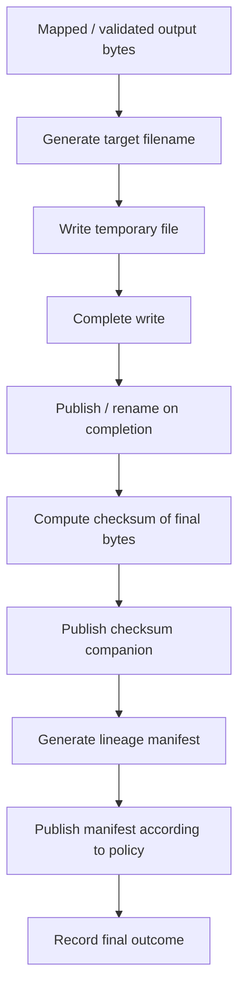

### Destination behavior

- Destination file name is resolved using the business date and run ID.
- Temporary publication uses a `.part` suffix.
- `RENAME_ON_COMPLETE` indicates the intended publication behavior after a completed write, assuming the endpoint/transfer implementation supports it.
- SHA-256 is computed over the final data-file bytes.
- The checksum companion is published after the data file according to the specified order.
- The manifest contains lineage and transfer/file details.

**Confirm that temporary-file/rename behavior is supported and atomic at the target filesystem/transfer endpoint.** Do not assume that every remote SFTP/MFT setup provides identical atomicity semantics.

---

## 13. Payload layouts

### `L_POSITIONS_FIXED` — source layout

The source layout is fixed-width, uses US-ASCII, byte-based offsets, record length 41, and a business date in `yyyyMMdd` format.

| Field | Position | Width / format | Meaning |
|---|---:|---|---|
| `tradeId` | 1–12 | 12 bytes | Trade identifier |
| `currency` | 13–15 | 3 bytes | Currency |
| `amount` | 16–33 | 18 bytes | Implied decimal, 2 decimal places |
| `businessDate` | 34–41 | 8 bytes | `yyyyMMdd` |

### Fixed-width layout concept

```text
| tradeId (12) | currency (3) | amount (18) | businessDate (8) |
|---------------|--------------|-------------|------------------|
| 1..12         | 13..15       | 16..33      | 34..41           |
```

The layout is byte-based, not character-count based. With US-ASCII the distinction is generally straightforward for these fields, but the parser should still implement the configured byte offsets and encoding explicitly.

### `L_RECON_DELIMITED` — target layout

The output layout is UTF-8, delimiter `|`, quote `"`, quote escaping by doubling the quote, and LF line endings. The layout defines record types:

- `HEADER`
- `DETAIL`
- `TRAILER`

The exact output field order and field values must be driven by the layout/mapping specification; they should not be invented where the configuration does not define them.

---

## 14. Routes and workflows

The configuration contains two routes for `SEC_LENDING`.

### `R_SEC_LENDING_EOD`

| Stage | Operation | Meaning |
|---|---|---|
| `B1` | `DISCOVER_AND_VERIFY_FILES` | Discover and verify source files from S4 |
| `B2` | `PARSE_FILE` | Parse with `L_POSITIONS_FIXED` |
| `B3` | `MAP` | Apply `M_LENDING_RECON_FILE` |
| `B4` | `DELIVER_FILE_AND_COMPANIONS` | Deliver output to T2 |

### `R_SEC_LENDING_RAW_COPY`

| Stage | Operation | Meaning |
|---|---|---|
| `C1` | `DISCOVER_AND_VERIFY_FILES` | Discover and verify S4 |
| `C2` | `MAP` | Apply `M_RAW_COPY` |
| `C3` | `DELIVER_FILE_AND_COMPANIONS` | Deliver to T2 with source filename/layout overrides |

Routes are workflow definitions. They sequence the stages; they should not contain hardcoded connection credentials or endpoint implementation details.

---

## 15. Workflow A: raw-copy route

Route: **`R_SEC_LENDING_RAW_COPY`**

Mapping: **`M_RAW_COPY` — `PASS_THROUGH`**

### Purpose

Copy the original file bytes without parsing or field-level transformation.

### Workflow

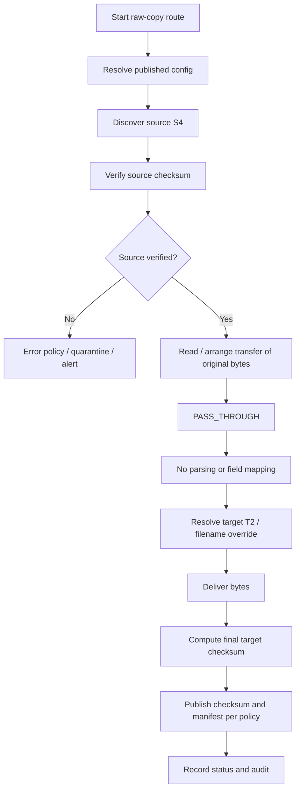

### Raw-copy behavior

1. Resolve interface, product, route, source, target, and policies.
2. Discover matching files at `S4`.
3. Verify source checksum according to policy.
4. Preserve the original file bytes.
5. Skip parsing and field-level mapping.
6. Apply the raw-copy mapping/target overrides as configured.
7. Deliver to T2.
8. Compute the checksum of the final destination data file.
9. Publish checksum companion and lineage manifest according to policy.
10. Record run and file outcomes.

### Important

Raw-copy means no business-field parsing/transformation. It does **not** mean that integrity, file eligibility, security, audit, or delivery controls are skipped.

---

## 16. Workflow B: reconciliation transformation route

Route: **`R_SEC_LENDING_EOD`**

Mapping: **`M_LENDING_RECON_FILE` — `TRANSFORM_FILE`**

### Purpose

Parse source position data, apply mapping and validation, and generate the reconciliation output format.

### Workflow

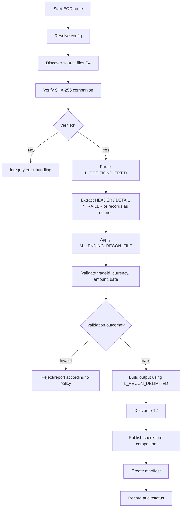

### Transformation behavior described

The mapping definition specifies:

- `TRANSFORM_FILE`.
- Source fixed-width layout.
- Output delimited layout.
- Header/detail/trailer handling.
- Validation of required `tradeId`.
- Currency validation against ISO 4217.
- Amount formatting.
- Date formatting.
- Rejection/reporting of invalid files or records according to configured policy.
- Error codes and source/line identifiers in rejection details.
- File integrity and delivery policy.

The implementation must follow the actual mapping specification for record order, field mapping, handling of rejected records, header/trailer totals and output construction. Do not assume undocumented rules.

---

## 17. End-to-end sequence

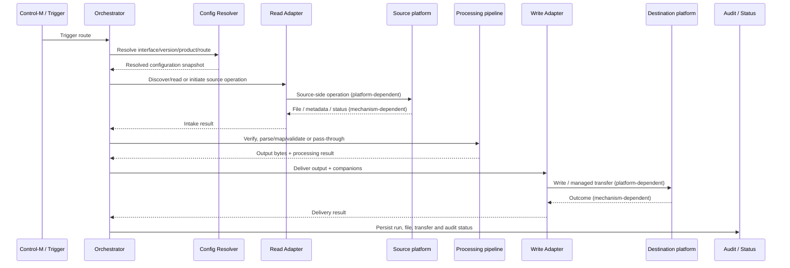

The sequence is logical. The physical data path depends on the actual transfer architecture.

---

## 18. Checksums and file integrity

The source and target configurations use SHA-256 checksum companions.

### Source verification

For each candidate source file:

1. Identify the file.
2. Identify the required checksum companion.
3. Read the file bytes and checksum value using the configured mechanism.
4. Compute SHA-256 over the source file bytes.
5. Compare computed and expected values.
6. Accept or reject the file according to the integrity policy.

A checksum mismatch for S4 is associated with `TECH-FILE-001` in the configuration context.

### Target checksum

For T2:

1. Complete the output file publication according to target policy.
2. Compute SHA-256 over the final published file bytes.
3. Write the checksum companion using the configured naming convention.
4. Record the checksum in the manifest/audit context.

### Integrity flow

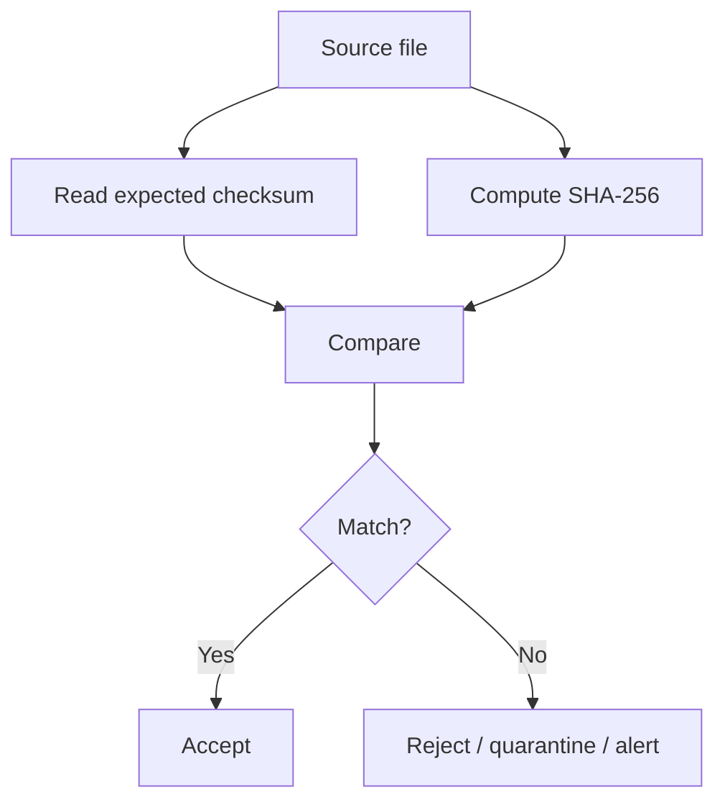

### Integrity does not prove business correctness

A matching checksum establishes that the bytes match the checksum value used for comparison. It does not prove that the data is correct, complete in business terms, valid, or trusted if both file and checksum were tampered with. The source of the checksum and the security of the transfer/storage must also be considered.

---

## 19. Temporary files and atomic publication

The T2 configuration describes:

- Temporary suffix: `.part`
- Publication mode: `RENAME_ON_COMPLETE`

### Intended pattern


This pattern reduces the chance that downstream consumers process an incomplete file under the final name.

**Platform caveat:** The exact rename behavior, visibility, overwrite semantics and atomicity must be confirmed for the remote filesystem and transfer mechanism. The configuration expresses intent; it does not guarantee the underlying endpoint's atomic behavior.

---

## 20. Manifest and audit lineage

T2 specifies a lineage manifest named:

`${target.fileName}.manifest.json`

The manifest is described as containing:

- Interface identity/version.
- Product.
- Run ID.
- Source name.
- Source checksum.
- Layout.
- Target name.
- Target checksum.
- Record count.

### Conceptual manifest

The following is an **illustrative shape only**. Confirm the schema and exact field names before implementation.

```json
{
  "interfaceId": "INT_CM_001",
  "interfaceVersion": "2.1.0",
  "product": "SEC_LENDING",
  "runId": "<generated-run-id>",
  "sourceName": "<source-file-name>",
  "sourceChecksum": "<sha256>",
  "sourceLayout": "L_POSITIONS_FIXED",
  "targetName": "<target-file-name>",
  "targetChecksum": "<sha256>",
  "targetLayout": "L_RECON_DELIMITED",
  "recordCount": "<count>"
}
```

### Audit should support answering

- Which interface and configuration version ran?
- Which product/route was used?
- What was the run ID?
- Which source file was selected?
- Was the source integrity check successful?
- What mapping/layout was applied?
- Which output file was produced?
- What checksum was generated?
- How many records were processed/rejected (if defined)?
- What was the final status?
- Which retries or recovery actions occurred?

Do not put secrets, private keys, passwords, or sensitive payload data in manifests or logs.

---

## 21. Security and credentials

The example uses SSH-key authentication profiles with Vault-style references.

### Security principles

- Do not store private keys or passwords directly in interface configuration.
- Use approved secret-management services and secret references.
- Restrict access to secret references and endpoint credentials.
- Use least privilege for source and destination access.
- Protect transfer-control and status interfaces.
- Protect logs, manifests and rejection files from exposure.
- Avoid logging file contents or sensitive fields unless approved.
- Rotate credentials according to enterprise policy.
- Verify host identity and SSH configuration where application-mediated SFTP is used.
- Validate authorization for transfer initiation, route execution and re-execution.

### Example secret references

```text
AUTH_MFT_IN  -> vault://cm/mft/input-key
AUTH_MFT_OUT -> vault://cm/mft/output-key
```

These are references from the example configuration, not actual credentials.

---

## 22. Retries, idempotency, recovery and error handling

The configuration context includes policies for retry, error handling, idempotency, audit, and file-integrity handling. The exact retry counts, intervals, status names and recovery procedures must be taken from the actual policy values and platform standards—not invented.

### Error categories (conceptual)

| Error category | Example | Typical handling to define |
|---|---|---|
| Source discovery | Directory/endpoint unavailable | Retry or fail according to policy |
| Integrity | Checksum mismatch | Reject/quarantine/alert according to policy |
| Parse | Fixed-width record invalid | Reject/report according to policy |
| Business validation | Required field/currency invalid | Reject/report according to policy |
| Transformation | Mapping failure | Fail/reject according to policy |
| Delivery | Target unavailable/write failure | Retry or recover according to policy |
| MFT operation | Transfer request/status failure | Platform-specific recovery |
| Configuration | Invalid/unpublished/missing reference | Fail fast and alert |
| Authentication | Credentials/authorization issue | Secure error, no credential leakage |

### Idempotency

The application should define how a repeat run is identified and how it avoids unintended duplicate outputs or processing. The example includes run IDs and re-execution considerations, but the final idempotency key, duplicate-detection rules, file disposition and overwrite behavior require explicit design.

Possible factors to consider—not prescribed values:

- Interface ID.
- Interface version.
- Product.
- Route.
- Source file identity.
- Business date.
- Run ID or a stable processing key.
- Output destination/name.

### Recovery

Recovery design should distinguish:

- Application workflow failure.
- Source-transfer failure.
- Destination-transfer failure.
- Partial transfer.
- Processing failure after intake.
- Delivery completed but audit/status update failed.
- Duplicate or re-executed run.

Do not assume that application retry and IBM MQ MFT retry are the same mechanism. Define how the two are correlated and coordinated.

---

## 23. Status tracking and observability

Application workflow status and IBM MQ MFT transfer status are related but not identical.

### Application-level stages (illustrative)

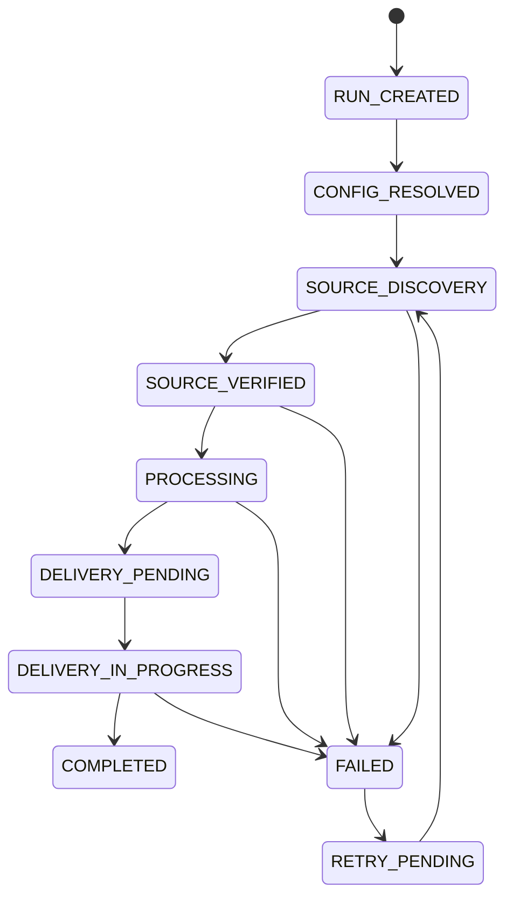

These are suggested application-level states, not asserted to be actual IBM MQ MFT status values or the existing configuration's exact state machine.

### Observability should include

- Run ID and correlation identifiers.
- Interface ID/version.
- Product and route.
- Source and target identifiers.
- Source/target filenames.
- Transfer request identifiers (when available).
- Application stage/status.
- Transfer status obtained from the supported platform mechanism.
- Checksum results.
- Record counts and validation outcome, where defined.
- Retry count and timestamps.
- Error code and safe error message.

---

## 24. What the Java/Spring Boot application communicates with

This depends on the selected architecture and IBM MQ MFT deployment. Do **not** assume one universal IBM MFT API.

The platform team must identify and approve the supported way for the application to:

1. Submit or initiate transfer operations.
2. Specify source and destination agents/endpoints.
3. Specify file paths, names and transfer options.
4. Obtain transfer identifiers.
5. Query, receive or otherwise observe transfer status.
6. Handle failure/recovery and permissions.
7. Correlate MFT operations with application run IDs.

### Possible implementation models

| Model | Description | Key implication |
|---|---|---|
| Agent-managed IBM MQ MFT | Application controls supported MFT transfer operations between managed agents | Requires deployment-specific agent, MQ and submission/status integration |
| Application-mediated SFTP | Spring application connects to SFTP endpoints and reads/writes file bytes | Application handles byte movement, connection management, integrity, retry and publication details |
| Hybrid | MFT handles some transfers while application handles other endpoint interactions | Must explicitly define ownership, boundaries and status correlation |

Do not commit to one model until the enterprise transfer environment and operational requirements are confirmed.

---

## 25. Proposed Spring Boot components

The following is a logical decomposition—not a final class/package design.

| Component | Responsibility |
|---|---|
| `ConfigurationResolver` | Resolve immutable interface/route/source/target/policy snapshot |
| `RouteOrchestrator` | Execute configured route stages in order |
| `ReadAdapter` | Abstract source discovery/read or transfer initiation |
| `WriteAdapter` | Abstract destination delivery or transfer initiation |
| `FileIntakeService` | File eligibility, metadata and integrity intake |
| `ChecksumService` | Compute/compare checksum values |
| `FileParser` | Parse source bytes using configured layout |
| `MappingService` | Apply route mapping/transformation |
| `ValidationService` | Apply structural/business validation |
| `TransferService` | Coordinate platform-specific transfer operations |
| `TransferStatusService` | Track transfer/application status |
| `RetryRecoveryService` | Apply configured retry/recovery policy |
| `AuditService` | Persist audit and lineage |
| `ManifestService` | Build manifest according to approved schema |

### Suggested separation

- Business-route logic should not contain endpoint connection details.
- Adapters should not implement business mapping.
- The orchestrator should not embed credentials.
- Configuration resolution should select a versioned snapshot.
- The platform-specific IBM MQ MFT or SFTP implementation should remain behind adapter boundaries.
- The status layer should correlate platform status with application status.

---

## 26. What needs to be provided to IBM MFT / platform team

Before implementing an IBM MQ MFT agent-based solution, request/confirm the following **as applicable to the actual deployment**:

### Environment and topology

- IBM MQ MFT version and deployment topology.
- Source and destination agent names/identifiers.
- Agent queue-manager details.
- Coordination queue-manager details, if applicable.
- Network connectivity and permitted transfer paths.
- Whether the source and destination agents are already configured and operational.

### Transfer control

- Approved mechanism for submitting transfer requests from an application.
- Required libraries, command interfaces, REST interfaces or other supported mechanisms—if available in this deployment.
- Permissions required for transfer initiation.
- Transfer request fields/options supported.
- Transfer identifier and status retrieval mechanism.
- How transfer completion and partial/failure states are exposed.

### Filesystem and transfer rules

- Source/destination directory permissions.
- File naming and wildcard support.
- Overwrite/disposition rules.
- Temporary-file/rename behavior.
- Atomic publication guarantees (if any).
- File size limits or operational constraints.
- Checksum workflow expectations.
- Source retention/archive policy.
- Destination cleanup policy.

### Operations

- Monitoring and alerting.
- Retry/recovery ownership.
- Transfer logs and operational support.
- Maintenance windows.
- Incident escalation.
- Audit requirements.
- Security and secret-management requirements.

This list is a discovery checklist, not a claim that IBM MFT requires every item in every deployment.

---

## 27. What must be clarified before implementation

The following decisions are blockers or important design inputs.

### 1. Is the target actually IBM MQ MFT?

The current example uses `MFT_SFTP` host/port/directory/SSH-key configuration. Confirm whether:

- IBM MQ MFT agents perform the transfers; or
- the application connects directly to SFTP; or
- a hybrid model is intended.

### 2. Who moves the bytes?

- IBM MQ MFT agents?
- Spring Boot using SFTP?
- A hybrid pipeline?

This determines adapter implementation and application resource requirements.

### 3. How will the application initiate and track transfer operations?

Obtain the exact supported submission/status integration and security model from the platform team.

### 4. What does “Read Adapter” return?

- File bytes?
- Local staged file?
- File metadata and transfer ID?
- Transfer completion status?
- A stream or storage reference?

The answer depends on the chosen model and file sizes.

### 5. What does “Write Adapter” accept?

- File bytes?
- A local staged path?
- A storage reference?
- Output metadata and transfer request?

Define the interface before implementation.

### 6. How are checksum companions handled?

Confirm companion file format, whitespace/newline convention, algorithm naming, source/destination retrieval and publication behavior.

### 7. What is the failure/recovery policy?

Confirm retry limits, retry delays, quarantine, source disposition, duplicate handling, partial transfers and manual recovery.

### 8. What are the output layout rules?

Confirm the full target schema, header/detail/trailer contents, record ordering, rejected-record policy, counts, and formatting rules.

### 9. Is `.part` + rename supported?

Confirm semantics at the actual target endpoint and transfer platform.

### 10. How are configuration versions and run IDs managed?

Confirm immutable published snapshots, run-ID generation, idempotency rules and re-execution behavior.

---

## 28. Glossary

| Term | Meaning |
|---|---|
| MFT | Managed File Transfer |
| IBM MQ MFT | IBM MQ Managed File Transfer capability |
| Agent | Managed transfer endpoint component in IBM MQ MFT |
| Agent queue manager | MQ infrastructure role associated with an MFT agent in the configured topology |
| Coordination queue manager | MFT coordination role in applicable topology |
| Source | Configured origin of files |
| Target | Configured destination of files |
| Read Adapter | Application abstraction for source-side discovery/read/transfer control |
| Write Adapter | Application abstraction for destination-side delivery/transfer control |
| Route | Configured sequence of workflow stages |
| Layout | Specification for interpreting or formatting file records |
| Mapping | Rule set for transforming or passing through data |
| Pass-through | Preserve bytes without business-field transformation |
| Checksum | Digest used to compare byte integrity, such as SHA-256 |
| Manifest | File describing processing and lineage metadata |
| Run ID | Identifier for an application execution |
| Idempotency | Design that avoids unintended duplicate processing/delivery |
| Atomic publication | Intended publication behavior where consumers do not see a partially written final file; endpoint semantics must be verified |

---

## 29. References and validation

### IBM MQ MFT documentation

Use official IBM documentation for the installed IBM MQ MFT version and the enterprise deployment configuration. Validate all agent, queue-manager, transfer-submission, status, command, API, retry and file-disposition details against that documentation and the platform team.

IBM maintains a public repository of IBM MQ MFT samples and documents:
- https://github.com/ibm-messaging/mq-mft

That repository is useful for sample exits, scripts and MFT-related examples, but it is **not a substitute** for the official documentation of the installed IBM MQ MFT version or for validating the enterprise deployment.

---

## Summary

The proposed integration layer is a configuration-driven orchestration application. It resolves a published interface configuration, selects a route, coordinates source intake, integrity verification, parsing/mapping when required, target delivery, checksums, manifest creation, audit, status and recovery.

The `R_SEC_LENDING_RAW_COPY` route preserves source bytes and skips business parsing/mapping. The `R_SEC_LENDING_EOD` route parses `L_POSITIONS_FIXED`, applies `M_LENDING_RECON_FILE`, validates and produces the configured delimited reconciliation output.

The Read and Write adapters isolate endpoint/transfer technology from the route logic. Their actual implementation depends on the confirmed transfer model: IBM MQ MFT agents, application-mediated SFTP, or hybrid. The example configuration's `MFT_SFTP` values do not by themselves establish IBM MQ MFT agent-to-agent transfer topology.

**The next step should be confirming the enterprise IBM MQ MFT topology and the supported application submission/status mechanism before writing adapter code.**
